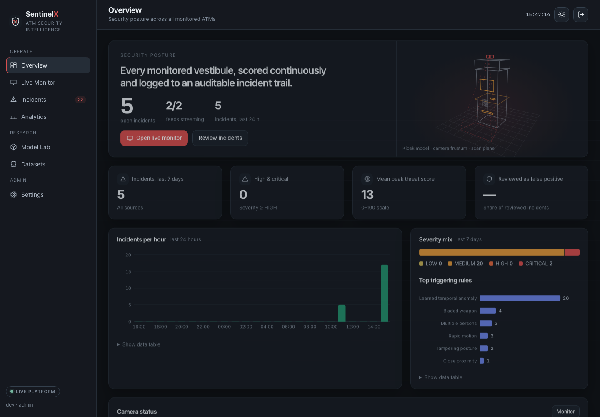

# SentinelX — AI security intelligence for ATM vestibules

[](https://www.python.org/)
[](https://palletsprojects.com/p/flask/)
[](https://github.com/ultralytics/ultralytics)
[](https://www.sqlite.org/)
[](tests/)
[](LICENSE)

SentinelX watches ATM vestibule cameras, detects and tracks people and threat objects, scores behaviour over
time, and turns sustained threats into **auditable incidents** with evidence, alerts and a review workflow.
It grew out of the original *AI-Based ATM Threat Detection System* in this repository. The original pipeline
is preserved in [`ml/baseline/`](ml/baseline/) and is used as the measured baseline for every result below.



> **Everything numeric in this README comes from scripts.** The detector and pipeline numbers are generated by
> `ml/evaluate_detector.py` / `ml/evaluate_pipeline.py` and rendered into [`docs/RESULTS.md`](docs/RESULTS.md)
> by `ml/make_results.py`. Nothing is typed by hand or simulated.

## What it does

| Capability | How |
|---|---|
| Person & object detection | YOLOv8n fine-tuned on a cleaned, licence-tracked Open Images V7 subset: person, knife, **firearm**, backpack, handbag, suitcase, bottle, **helmet**, blunt tool |
| Tracking & dwell time | ByteTrack IDs (IoU fallback), per-camera polygon zones, dwell time inside the ATM zone, posture, speed |
| Behaviour rules | multiple persons, close proximity (shoulder-surfing / coercion), loitering, tampering posture, rapid motion, weapons/tools with temporal persistence, face concealment, unattended bags, restricted zones, **camera tampering** (lens covered/defocused) |
| Temporal analysis | sliding-window features plus a logistic **temporal anomaly head** trained on ATMA-V *train*, selected on *val*, reported on *test* |
| Incidents | open / escalate / close lifecycle, peak score and severity, sampled detections, model & engine version, dataset provenance |
| Evidence | annotated snapshots and H.264 pre-roll clips on private storage (0600, SHA-256), never in the DB or `static/` |
| Alerts | severity gate, per-camera cooldown, de-duplication, escalation bypass, optional webhook |
| Review | status workflow (open → acknowledged → investigating → resolved / false positive), notes, assignee, full audit trail |
| Platform | role-based access (viewer / analyst / admin), CSRF, throttled login, migrations and backups, health endpoint |
| Dashboard | Obsidian & Signal Red design, dark/light, live annotated feeds, threat gauge, analytics, Model Lab, dataset registry |

**Provenance is never hidden.** Every feed, incident and alert is labelled **LIVE** (camera stream), **RECORDED**
(a video file replayed through the live pipeline) or **DEMO** (precomputed data in the serverless build).

<!-- RESULTS:START -->
## Results (held-out test splits)

All values were copied from [`docs/RESULTS.md`](docs/RESULTS.md), which `ml/make_results.py` generates from `reports/`.
The AP implementation agrees exactly with `pycocotools` (max |ΔAP| = 0.0 on both models).

**Object detector**, Open Images V7 SentinelX subset, 1,437 test images, photographer-disjoint from training:

| | Original `yolov8n-coco` | SentinelX `sentinelx-det-v1` |
|---|---|---|
| mAP50 / mAP50-95, 7 shared classes | 44.4 / 31.5 | **62.2 / 43.0** (+17.8 pts mAP50; 95% bootstrap CI of the difference [12.7, 22.1]) |
| Firearm / helmet AP50 | not supported | 0.756 / 0.767 |
| Knife AP50 (recall @ conf 0.25) | 0.480 (0.33) | **0.718 (0.73)** |
| Person AP50 | **0.794** | 0.721 — *regression* |
| Suitcase AP50 (63 boxes) | **0.550** | 0.414 — *regression* |
| Median latency, Apple M3 Pro MPS / CPU | 12.7 / 30.4 ms | 11.8 / 29.4 ms |

**End-to-end threat pipeline**, ATMA-V test (21 videos, group-aware split) and SCFD test (179 clips, cross-dataset):

| Pipeline | ATMA-V frame AUC | Precision / recall / FPR at incident threshold | Anomalous videos detected | False alarms per minute of normal video | SCFD clip AUC |
|---|---|---|---|---|---|
| Original v0 | 0.499 | 0.68 / 0.28 / 0.23 | 69% | 3.62 | 0.639 |
| **SentinelX (v1 detector + rules + temporal head)** | **0.642** | 0.73 / **0.94** / 0.61 | **100%** | **1.89** | 0.651 |

What this means, without spin:
- The fine-tuned detector is significantly better overall and adds firearm and helmet detection, but it is
  **worse at person detection** than COCO-pretrained YOLOv8n (likely because Open Images person boxes are not
  exhaustive). Person recall drives the behaviour rules, so this is the first thing to fix in v2.
- The original pipeline ranked anomalous ATMA-V frames at chance level (AUC 0.50). SentinelX reaches 0.64,
  detects every anomalous test video and roughly halves false alarms per minute. Its **frame-level false-positive
  rate at the incident threshold is high (0.61)**. Use `alert_min_severity = HIGH` (the default) for alerts, where
  precision / recall / FPR are 0.70 / 0.34 / 0.25.
- Rules alone, without the temporal head, do not beat the original on AUC. Most of the gain comes from the learned
  OpenCV motion cues, which were selected on validation data only.
<!-- RESULTS:END -->

## Quick start (local)

Requirements: Python 3.11–3.13, ~2 GB disk for dependencies. Apple-silicon (MPS), CUDA or CPU all work.

```bash
git clone https://github.com/saharsh-lab/ATM-threat-detection-system.git
cd ATM-threat-detection-system
python3 -m venv .venv && source .venv/bin/activate
pip install -r requirements-local.txt          # full stack (requirements.txt is the Flask-only Vercel build)

cp .env.example .env                           # optional: set SENTINELX_SECRET_KEY etc.
python manage.py init                          # create the database, then the first admin account (prompts)
python app.py                                  # http://127.0.0.1:5001
```

Sign in with the admin account. By default two **recorded** ATMA-V videos replay through the live pipeline
([`config/cameras.example.yaml`](config/cameras.example.yaml)). Add real cameras in `config/cameras.yaml`:

```yaml
cameras:
  - id: branch12-lobby
    name: Branch 12 lobby
    source: {type: rtsp, url_env: SENTINELX_CAM03_URL}     # URL with credentials lives in the environment
    zones:
      atm_zone: [[0.30, 0.20], [0.75, 0.20], [0.80, 1.00], [0.25, 1.00]]
      loitering_seconds: 45
```

More accounts: `python manage.py create-user alice --role analyst`.

## Reproduce the data, model and results

```bash
pip install -r requirements-dev.txt

# 1. Datasets (see docs/DATASETS.md for licences and what could not be acquired)
python -m ml.datasets.openimages reproduce     # exact v1 detection dataset from the committed manifest (~650 MB)
python -m ml.datasets.atmav                     # validate ATMA-V labels/checksums, write group-aware splits
python -m ml.datasets.scfd                      # Surveillance Camera Fight Dataset (~90 MB, not committed)

# 2. Train the detector (≈4 h on an M3 Pro via MPS; config in ml/configs/train_v1.yaml)
python -m ml.train --config ml/configs/train_v1.yaml

# 3. Evaluate (one implementation for every model and variant)
python -m ml.evaluate_detector --models yolov8n-coco sentinelx-det-v1
python -m ml.train_temporal --model sentinelx-det-v1      # fit on ATMA-V train, select on val
python -m ml.evaluate_pipeline --splits test --device cpu
python -m ml.make_results && python manage.py export-static
pytest
```

`python -m ml.datasets.openimages all` rebuilds the dataset from the official Open Images CSVs instead of the
manifest (it streams about 5.6 GB, keeps only SentinelX rows, and resumes on connection drops).

### Model weights and Git LFS
The released weights are small (`yolov8n.pt` and `models/sentinelx-det-v1.pt` are about 6 MB each), so they are
committed directly with their SHA-256 in [`models/registry.yaml`](models/registry.yaml). Git LFS is **not**
required. For larger future models (e.g. YOLOv8m at about 50 MB or more), either attach the weights to a GitHub
Release and record the URL and checksum in the registry, or enable LFS:

```bash
git lfs install && git lfs track "models/*.pt" && git add .gitattributes
```

## Database

SQLite in WAL mode (`instance/sentinelx.db`, git-ignored). The schema lives in versioned SQL migrations
([`db/migrations/`](db/migrations/)) that are applied automatically at start-up or with `python manage.py migrate`.
Each migration runs in a transaction and is checksum-protected, and a backup is taken first whenever the
database already holds data. Before SentinelX the project kept events only in memory, so no prior data needed
migrating.

```bash
python manage.py backup                         # consistent online backup → instance/backups/ (0600)
python manage.py restore instance/backups/<file>.db
python manage.py check                          # integrity check + migration status
python manage.py purge-evidence --days 30       # retention
```

Tables: `incidents` (ID, camera, live/recorded/demo, timestamps, frames, threat and peak score, severity, review
status, reasons, rules, detection classes, max confidence, model version, engine version, training dataset),
`incident_detections`, `evidence_files` (paths + SHA-256 only), `alerts`, `audit_log`, `users`, `cameras`,
`model_versions`, `datasets`, `settings`, plus an FTS5 index for search.

## API (selected)

| Method | Path | Role |
|---|---|---|
| GET | `/api/health` | public (no sensitive data) |
| GET | `/api/cameras`, `/api/cameras/<id>/state`, `/api/cameras/<id>/stream` | viewer |
| GET | `/api/incidents?severity=&status=&source=&camera=&q=&since=&page=&sort=` | viewer |
| PATCH | `/api/incidents/<id>` `{status, notes, assigned_to}` | analyst |
| GET | `/api/evidence/<id>` (audited) · `/api/incidents/export.csv` | analyst |
| POST | `/api/cameras/<id>/video` · `/api/videos` (upload, validated) | analyst |
| GET/PUT | `/api/settings` (thresholds) · GET `/api/audit` · POST `/api/admin/backup` | admin |

The original endpoints `/video_feed`, `/threat_data` and `/switch_video` still work.

## Serverless demo (Vercel)

`api/index.py` serves the same dashboard in **demo mode**: precomputed detections from the real pipeline
(`static/data/threat_timelines.json`, regenerated with `python -m ml.export_timeline`) and the committed evaluation
reports. It has no database, no evidence and no live inference, and every page says so.

## Project layout

```
app.py                 start the local server
manage.py              admin CLI (init database, create users, export static data)
config.py              all settings (override with SENTINELX_* env vars or .env)
config/                camera configuration (cameras.example.yaml → copy to cameras.yaml)

core/                  the engine: detector, tracker, zones, temporal, threat rules,
                       incidents, alerts, evidence, camera workers, frame drawing, database
web/                   Flask app: auth/roles, REST API, pages
templates/, static/    dashboard (no build step; ES modules, SVG charts, canvas 3D)
api/                   Vercel serverless demo entry point
db/migrations/         SQL migrations

ml/                    dataset builders, training, evaluation, demo-timeline export,
                       frozen v0 baseline (ml/baseline/)
data/                  committed dataset metadata: registry, manifests, ATMA-V labels and videos
models/                model registry and temporal heads
reports/               evaluation reports (JSON, Markdown, figures)
docs/                  DATASETS, RESULTS, ARCHITECTURE, SECURITY
tests/                 pytest suite

Not committed (local only): datasets/ (downloaded images), runs/ (training output),
instance/ (database, evidence, backups), venv_mac/ or .venv/ (Python environment)
```

## Limitations

- **ATM-specific labelled data is scarce.** No licence-clear ATM dataset with bounding boxes exists (see
  [`docs/DATASETS.md`](docs/DATASETS.md)), so the detector learns from general photos. ATMA-V provides
  only 65 videos with temporal labels, so the pipeline numbers have wide uncertainty, and the temporal head is
  a small linear model by design.
- The pipeline is evaluated with a single default zone (5–95% of the frame) for every video. Real deployments
  should draw per-camera zones, which the engine supports, and re-tune thresholds on their own footage.
- Weapon detection on small, low-resolution CCTV objects is hard. Check per-class recall in
  [`docs/RESULTS.md`](docs/RESULTS.md) before relying on a single rule.
- SentinelX is decision support for trained operators. It does not dispatch police, identify people or perform
  face recognition. Read [`docs/SECURITY.md`](docs/SECURITY.md) before deploying.

## Licences

Code: MIT ([LICENSE](LICENSE)). Data keeps its own licences. ATMA-V videos are CC BY-SA 4.0
([attribution](data/videos/ATTRIBUTION.md)). Open Images annotations are CC BY 4.0 and images are listed as
CC BY 2.0 (per-image authors in the manifest). SCFD is MIT, with clips not redistributed here. `yolov8n.pt` and
the fine-tuned weights derive from Ultralytics YOLOv8 (AGPL-3.0); review the Ultralytics licence before any
commercial use.
