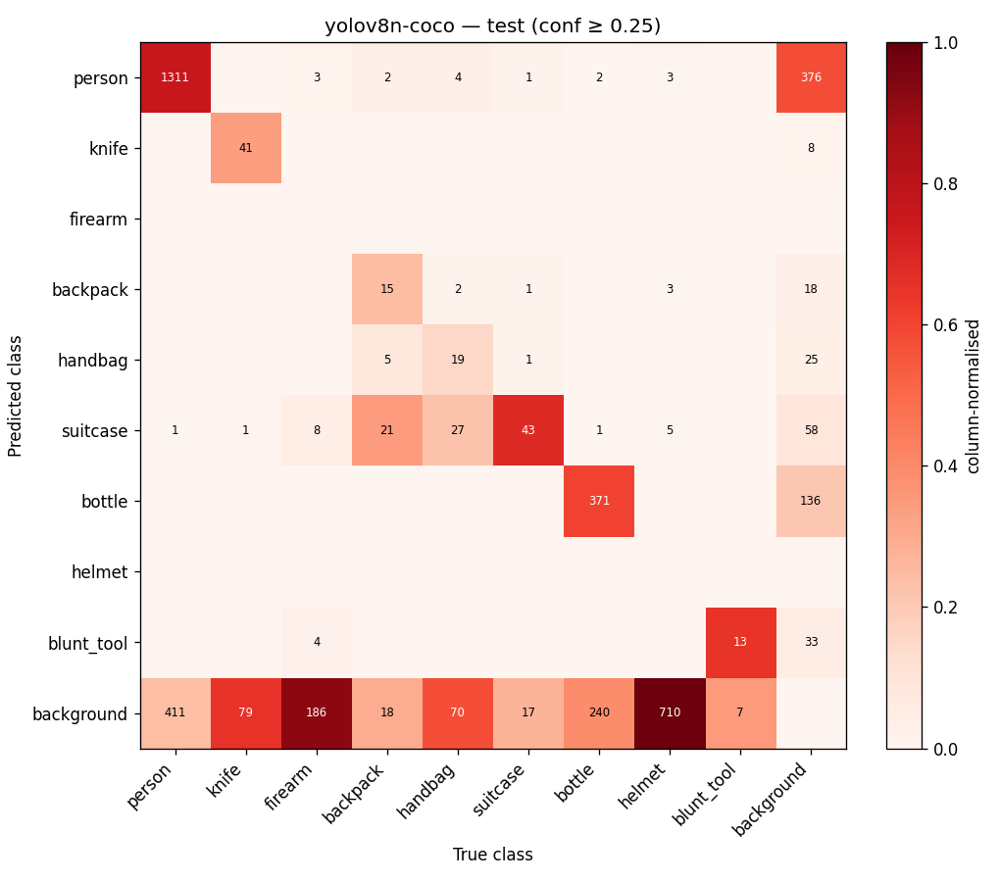
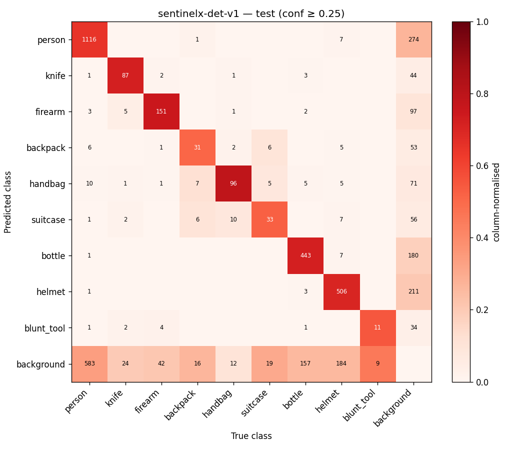

# Detector evaluation — openimages_v7_sentinelx_v1 (test)

Generated 2026-10-14T10:04:53+00:00 by `ml/evaluate_detector.py`. Dataset version `6495ad20fbf022c7`, 1437 images. Protocol: imgsz 640, COCO 101-point, IoU 0.50:0.05:0.95, operating confidence 0.25. All numbers are produced by the script — none are hand-entered.

## Summary

| Model | mAP50 (shared classes) | mAP50-95 (shared) | mAP50 (all 9 classes, unsupported=0) | mAP50-95 (all 9) |
|---|---|---|---|---|
| `yolov8n-coco` | 0.444 | 0.3153 | 0.3454 | 0.2453 |
| `sentinelx-det-v1` | 0.6215 | 0.4301 | 0.6527 | 0.4424 |

Shared classes (supported by every model): person, knife, backpack, handbag, suitcase, bottle, blunt_tool.

Image-level bootstrap (300 resamples), 95% CI of shared-class mAP50:
- `yolov8n-coco`: [0.4088, 0.4918]
- `sentinelx-det-v1`: [0.5772, 0.6718]
- difference (sentinelx-det-v1 - yolov8n-coco): mean 0.1718, 95% CI [0.1265, 0.2211], P(Δ ≤ 0) = 0.0

## Per-class AP50 / AP50-95

| Class | GT boxes | `yolov8n-coco` AP50 | `yolov8n-coco` AP50-95 | `sentinelx-det-v1` AP50 | `sentinelx-det-v1` AP50-95 |
|---|---|---|---|---|---|
| person | 1723 | 0.794 | 0.6047 | 0.7209 | 0.4881 |
| knife | 121 | 0.4801 | 0.3726 | 0.7177 | 0.4979 |
| firearm | 201 | unsupported | — | 0.756 | 0.4921 |
| backpack | 61 | 0.2084 | 0.1011 | 0.5419 | 0.3646 |
| handbag | 122 | 0.1568 | 0.1198 | 0.7761 | 0.6557 |
| suitcase | 63 | 0.5501 | 0.3713 | 0.4136 | 0.2255 |
| bottle | 614 | 0.6647 | 0.505 | 0.7543 | 0.5887 |
| helmet | 721 | unsupported | — | 0.7675 | 0.4787 |
| blunt_tool | 20 | 0.2542 | 0.1327 | 0.4258 | 0.1906 |

## Operating point (conf ≥ 0.25)

| Class | `yolov8n-coco` P / R / image-FPR / FPPI | `sentinelx-det-v1` P / R / image-FPR / FPPI |
|---|---|---|
| person | 0.7709 / 0.7615 / 0.0533 / 0.2714 | 0.8033 / 0.6518 / 0.0329 / 0.1914 |
| knife | 0.8163 / 0.3306 / 0.0022 / 0.0063 | 0.6377 / 0.7273 / 0.0185 / 0.0348 |
| firearm | unsupported | 0.5946 / 0.7662 / 0.0327 / 0.0731 |
| backpack | 0.4359 / 0.2787 / 0.0101 / 0.0153 | 0.3846 / 0.6557 / 0.033 / 0.0445 |
| handbag | 0.4 / 0.1639 / 0.0121 / 0.0209 | 0.4925 / 0.8115 / 0.0603 / 0.071 |
| suitcase | 0.2788 / 0.7302 / 0.0522 / 0.0828 | 0.313 / 0.5714 / 0.0365 / 0.055 |
| bottle | 0.7318 / 0.6042 / 0.016 / 0.0946 | 0.7068 / 0.7264 / 0.0284 / 0.1287 |
| helmet | unsupported | 0.7171 / 0.7171 / 0.0517 / 0.142 |
| blunt_tool | 0.26 / 0.65 / 0.0183 / 0.0257 | 0.2075 / 0.55 / 0.0211 / 0.0292 |

## Latency (end-to-end per image, batch 1)

| Model | Device | mean ms | p50 ms | p95 ms | FPS |
|---|---|---|---|---|---|
| `yolov8n-coco` | mps | 29.44 | 12.72 | 181.15 | 34.0 |
| `yolov8n-coco` | cpu | 30.91 | 30.36 | 38.1 | 32.4 |
| `sentinelx-det-v1` | mps | 14.14 | 11.78 | 36.33 | 70.7 |
| `sentinelx-det-v1` | cpu | 30.24 | 29.35 | 38.24 | 33.1 |

## Confusion matrices

## Metric implementation check

The same predictions were re-scored with the reference `pycocotools` COCOeval:
- `yolov8n-coco`: max |ΔAP50| = 0.0, max |ΔAP50-95| = 0.0
- `sentinelx-det-v1`: max |ΔAP50| = 0.0, max |ΔAP50-95| = 0.0

Environment: macOS-26.6.2-arm64-arm-64bit-Mach-O, Python 3.13.5.
